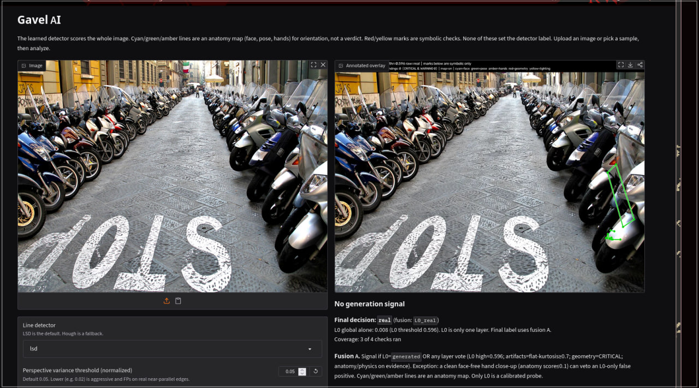
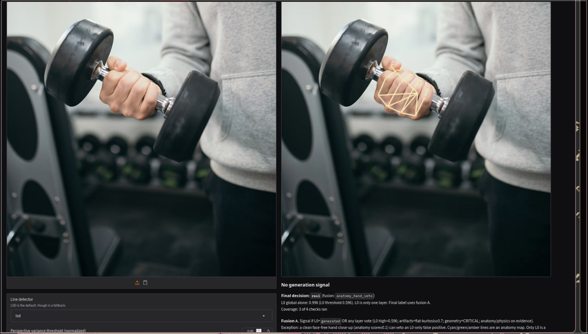
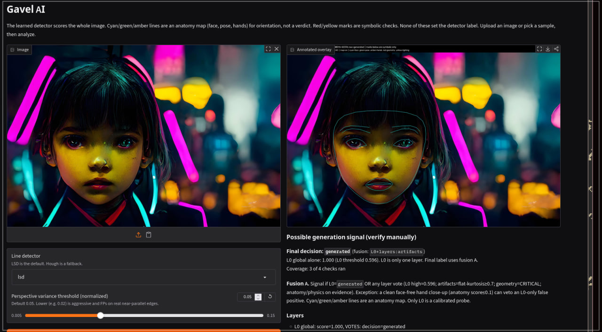
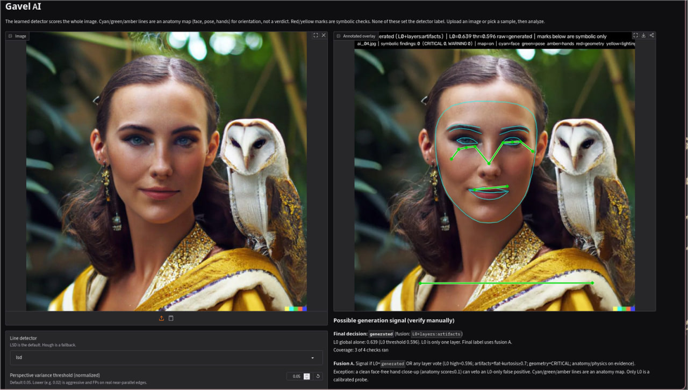
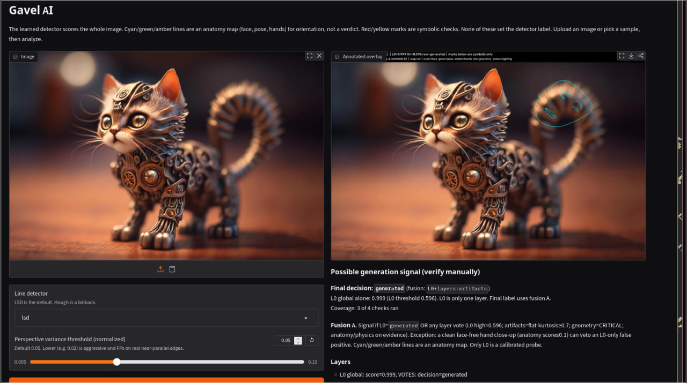
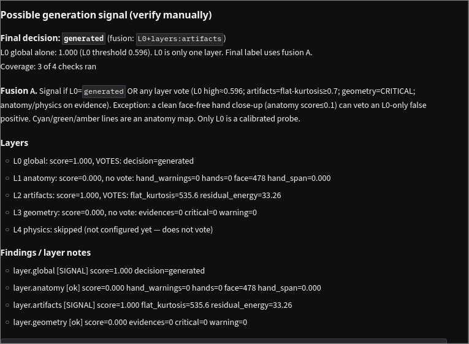

# Gavel AI

English: [README.md](README.md)

Прототип с лицензией **Apache-2.0**: ищет *признаки* генерации изображения. Это **не** вердикт «это точно AI» — только сигнал для ручной проверки.

## Что внутри

| Слой | Роль | Голос |
|---|---|---|
| **L0 global** | CLIP ViT-L/14 + линейный зонд → `generated` / `uncertain` / `real` | Да (порог ≈ **0.596**) |
| **L1 anatomy** | Карта face / pose / hands; WARNING только по 2D правилам рук | Да при evidence |
| **L2 artifacts** | Kurtosis residual на «плоских» патчах | Мягкий: вместе с L0 uncertain/generated; **не перебивает L0=`real`** |
| **L3 geometry** | LSD + точки схода (RANSAC) | Да только на **CRITICAL** (default thr **0.05**) |
| **L4 physics** | Свет / тени | Пока skipped |

**Fusion A:** финал `generated`, если L0=`generated` или есть жёсткий голос слоя.

Исключения:

- **`anatomy_hand_veto`** — чистая крупная рука без лица (anatomy ≤ 0.1) может снять L0-only FP (кейс gym hand).
- **Soft artifacts** — игнорируются, если L0 уже сказал `real` (ночные/текстурные фото).

Широкие диптихи: дополнительно считаются left/right тайлы, берётся max по L0.

## Скриншоты

Те же файлы, что в английском README — каталог [`assets/readme/`](assets/readme/).

<p align="center">
  
  
</p>

<p align="center">
  
  
</p>

<p align="center">
  
  
</p>

## Архитектура

```
agents/       LSD, MediaPipe anatomy, light stub
core/         pipeline, L0, fusion (verdict), validators
visualizer/   overlay (карта + символьные метки)
app.py        Gradio
analyze.py    CLI
training/     extract / train / eval_samples_gate / calibrate_artifacts
models/       shipped weights + thresholds (exp_* в .gitignore)
samples/real/ лицензионные тестовые фото
assets/readme/ скрины UI
```

Поток: картинка → L0 + слои → `EvidenceProtocol` (JSON) + annotated overlay. Сломанный/пропущенный этап помечается `skipped`, остальные продолжают работать.

## Установка

Python **3.11+**. Для L0 нужны `torch` и `open_clip_torch` (~1.7 GB CLIP при первом запуске). Для карты рук/лица — MediaPipe 0.10.x.

```bash
python -m venv .venv && source .venv/bin/activate
pip install -r requirements.txt
# по желанию: uv pip install "mediapipe==0.10.14"
```

## Быстрый старт

```bash
python -m pytest -q
python app.py --share
python analyze.py samples/real/*.jpg --out-dir results
```

Шипнутые файлы: `models/detector_weights.npz`, `models/thresholds.json`, `models/layer_thresholds.json`, `models/metrics.json`.

## Веб-интерфейс

Gradio (`app.py`): загрузка / сэмпл → Analyze → overlay + summary (final decision, fusion, слои).  
Баннер: **Final** отдельно от сырого L0. Cyan/green/amber — карта анатомии, не вердикт.

Слайдер perspective: default **0.05** (0.02 агрессивно и даёт FP на почти параллельных рёбрах).

## L0

- OpenCLIP ViT-L/14, замороженный; голова — логистическая регрессия.
- Нормализация общая для train/infer: resize → crop 448 → JPEG q90.
- High ≈ 0.596 (калибровка ~1% FPR на real cal), low ≈ 0.066.
- Это **семантический** зонд, не форензика пикселей.

## Обучение и гейт

Датасеты снаружи репо (например `/mnt/disk-e/gavel-data`). Не тащить `ai_vs_real_real` в train.

```bash
python training/eval_samples_gate.py
python training/calibrate_artifacts.py --root /mnt/disk-e/gavel-data

# После своих фото рук в $ROOT/real/hands/
python training/extract_features.py --source real_hands --root "$ROOT"
./training/retrain_when_hands_ready.sh
```

Ship вручную только при GATE PASS и нормальных метриках (не «всё uncertain»).

## Ограничения

1. Stock close-up рук — L0 может дать ~0.99; пока спасает `anatomy_hand_veto`.
2. Artifacts на ночи/текстуре могут гореть, но не перебивают L0=`real`.
3. Geometry при thr 0.02 ложно срабатывает на реальных параллелях.
4. Physics не подключён.
5. Часть OOD AI (диптихи) ещё проходит как `real` по L0.
6. Не использовать как единственное «доказательство».

## Тесты

```bash
python -m pytest -q
```

## Лицензии

- **Код:** Apache-2.0 — [LICENSE](LICENSE).
- **Сэмплы real:** Wikimedia (CC BY 2.0 / CC0 / CC BY-SA 4.0) — таблица в [README.md](README.md#image-sources-and-licenses).
- **`samples/ai_generated/`** в git не входит (лицензия датасета неясна).
- Обучающие корпуса и веса CLIP сюда не кладутся.
